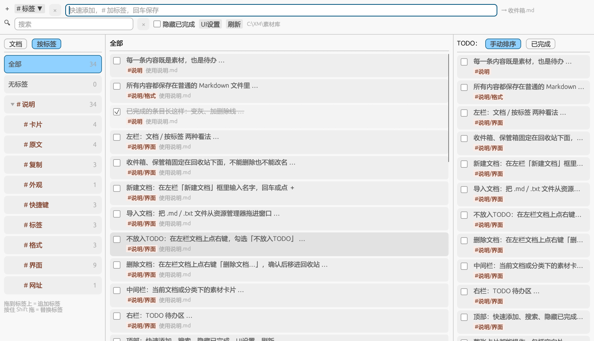

# 素签 sucard · 素材库兼待办

**sucard** is a lightweight desktop app (Rust + egui) for collecting snippets and to-dos.
Every item is a plain Markdown task line (`- [ ] text #tag`), so your data stays readable in any editor, Obsidian or Typora.
It shows the same items as cards (by document or by tag) and as a to-do list, idles at 0% CPU, and stays smooth with thousands of items.
The UI is in Chinese.

一个用 Rust + egui 写的轻量桌面工具。每条内容既是素材，也是待办：它同时出现在左侧的文档 / 标签里和右侧的待办区，用过就划掉。
数据就是普通的 Markdown 文件，用记事本、Typora、Obsidian 都能打开。



## 下载

到 [Releases](https://github.com/bestfullai/sucard/releases) 下载对应系统的压缩包，解压后直接运行 `sucard`（Windows 是 `sucard.exe`）。

默认数据目录是用户目录下的 `素材库` 文件夹，也可以在命令行指定：

```bash
sucard D:/我的素材          # 指定数据目录
```

或者用环境变量 `SUCARD_DIR` 指定。

第一次使用某个数据目录时，会自动生成一份 `使用说明.md`：它本身就是示例文档，每条说明都是一条可以操作的素材。
删掉后可以在「UI设置」里点「重新生成使用说明」再生成（已有同名文件时不覆盖，另存为「使用说明 2.md」）。

## 从源码编译

先装好 Rust（https://rustup.rs），然后在本目录下运行：

```bash
cargo run --release              # 默认使用 ~/素材库 作为数据目录
cargo run --release -- D:/我的素材 # 指定数据目录
cargo test                       # 运行测试
```

编译好的程序在 `target/release/sucard`（Windows 下是 `sucard.exe`），可以单独拷走使用。

各平台的额外准备：

- **Windows**：默认的 MSVC 工具链需要安装 [Visual Studio Build Tools](https://visualstudio.microsoft.com/visual-cpp-build-tools/)（勾选“使用 C++ 的桌面开发”）。
  不想装的话可以用 GNU 工具链：`rustup default stable-x86_64-pc-windows-gnu`，再装 [WinLibs](https://winlibs.com/) 的 MinGW-w64，并把它的 `bin` 加到 PATH。
- **Linux**：需要窗口、键盘和剪贴板相关的开发库。Debian / Ubuntu：
  `sudo apt-get install libxcb-render0-dev libxcb-shape0-dev libxcb-xfixes0-dev libxkbcommon-dev libssl-dev`
- **macOS**：装好 Xcode Command Line Tools（`xcode-select --install`）即可。

使用说明 `assets/使用说明.md` 在编译时打包进程序。

## 界面

- **顶部**：快速添加。输入内容，用 `#标签` 分类，回车保存。
  输入框左边的「# 标签」和卡片右键「编辑标签…」是同一个面板：可以新建标签，点已有标签加上 / 去掉（可以连点多个），也可以清除全部标签。改的是输入框里的文字，回车保存时才写入。
  左侧选中了某个文件，就加进那个文件；否则加进 `收件箱.md`。
  左侧“按标签”里选中了某个标签，新条目会自动带上这个标签（已经写了它或它的子标签就不重复加）。
- **左侧**：在“文档”和“按标签”之间切换。
  - 文档：显示数据目录里所有的 `.md` / `.txt`（只看数据目录这一层，子文件夹不读取）。把条目拖到文件上，就是移进这个文件。
    从资源管理器把 `.md` / `.txt` 拖进窗口即可导入：复制进数据目录（原文件不动），同名时改名为「名字 2.md」，和现有条目重复的 `^id` 会重新编号；拖动时有提示，其他类型或非 UTF-8 的文件跳过并提示。
    文件上点右键勾选「不放入TODO」：这个文档的条目不在右栏显示（左栏名字变淡，再点取消）。
    文件上点右键「删除文档…」，确认后整个文档（连同里面的素材）移进回收站。
  - 回收站：在文件列表最下面。可以还原（回到原位置，原位置已有同名文件时改名为「名字（恢复）.md」），
    也可以彻底删除；支持勾选批量删除和清空。彻底删除不能恢复，会先确认。
    回收站的文件放在 `数据目录/.sucard/回收站/`。
  - 收件箱、保管箱：固定在回收站下面（数据目录里的 `收件箱.md`、`保管箱.md`）。
    不能删除、不能改名，缺了会在启动时自动建好；其他用法和普通文档一样。
  - 按标签：按标签汇总，支持 `#资料/AI` 这样的层级；有子标签的标签前面有箭头，点它或双击标签折叠 / 展开（会记住）。「无标签」是没有标签的条目。拖到标签上会追加标签，按住 Shift 拖则替换全部标签。
- **中间**：当前文件或分类下的条目卡片。选中一个文件时，可以点“阅读原文”整篇只读查看，或点“编辑原文”整篇编辑。
  - 阅读原文：标题去掉 `#` 并放大，`- [ ]` / `- [x]` 显示成 □ / ■，不显示 `^id`；文字可拖选复制，网址单击打开；文件变了自动刷新。
  - 编辑原文会着色：`- [ ]` 强调色，已完成的条目变灰加删除线，`#标签` 用标签色，`^id` 变淡；`- [ ]` 带底色，方便看出每条从哪开始。
  - Ctrl+S 保存（留在编辑区）；改了没保存时标题旁显示「● 未保存」。
  - 返回 / Esc / 点左栏别处时，如果有改动会先问：保存（回车）/ 不保存 / 继续编辑（Esc）。
    右键菜单里的「返回（不保存）」直接放弃改动。
  - 底部显示行数、字数（不含空白）、素材条数。
- **右侧**：TODO 待办区（不放入TODO 的文档除外）。
  - 手动排序：还没完成的条目，拖动排序，顺序会被记住。
  - 已完成：勾掉的条目（不能拖动），取消勾选就回到手动排序。顶部“隐藏已完成”只影响中间栏。

操作：中间和右侧的每条都是一块卡片，整块（包括空白处）都能操作——单击选中，双击编辑，右键可编辑、标记或删除，按住任意位置拖动。
卡片右键「复制全部」：复制这条的全部正文（多行完整复制），不含 `#标签`和 `%%备注%%`。
卡片右键「部分复制」：只复制 `==标记==` 的内容（同一行的几处用空格连起来，不同行分行）；没有标记时是灰的。
标记的写法是 Obsidian 的高亮 `==…==`，卡片和编辑原文里显示黄色底色；落在 `%%备注%%` 里的标记不算。
在编辑原文里选中文字点「复制选中」，或在任何编辑框里按 Ctrl+E、右键「复制选中 / 取消」即可加上 / 去掉。
不想被复制的文字写成 `%%备注%%`（可以在行内，也可以跨行），卡片和编辑原文里显示成灰色；
这是 Obsidian 的注释写法，用 Obsidian 打开时这部分会被隐藏。
备注里的 `#标签` 不算标签：不出现在标签块和左栏分类里，卡片上作为备注文字灰色显示。
不用手打 `%%`：在编辑原文里选中文字，点标题栏的「忽略复制」；或者在任何编辑框里选中后按 Ctrl+/、右键「忽略复制 / 取消」。
对已经是备注的文字再做一次就是取消。
网址（`http://`、`https://`、`www.` 开头）：卡片和编辑原文里显示为链接色加下划线，**Ctrl+单击**用浏览器打开（单击仍是选中卡片 / 放光标）。
卡片右键有「打开链接」「复制链接」；有多个网址时逐个列出，另有「复制全部链接」。备注 `%%…%%` 里的网址也算。

卡片右键「编辑标签…」：点已有标签加上 / 去掉（可以连点，换标签就是去掉旧的再点上新的），顶部输入框可以直接新建标签，底部可以清除全部标签。
编辑状态下右键是撤销、重做、剪切、复制、粘贴、全选。
选中后可以用键盘：空格 切换完成，回车 编辑，Delete 删除，Esc 取消选中。顶部可以勾选“隐藏已完成”。
删除（右键「删除」、Delete 键、编辑时把内容删光再保存）都会先弹确认框：回车 = 删除，Esc 或点框外 = 取消。

## 数据格式

所有内容都是普通 Markdown 任务行，用 Obsidian、Typora 或记事本都能打开和编辑：

```markdown
- [ ] 短视频开头三秒要抛问题 #灵感 ^k3f9a2
- [x] AI 工具测评的链接和要点 #资料/AI ^p0x7mz
```

- 一条可以有多行：第二行起缩进写在任务行下面，这是标准 Markdown 写法，Obsidian / Typora 也会显示成同一条：

  ```markdown
  - [ ] 《我记得你眼里的依恋》 #歌词 ^ziiqrr
    男：为什么痴心两处总难相见
    女：徘徊在起风的午夜……
  ```

  任务行下面缩进的文字和普通子列表都算这一条；缩进的 `- [ ]` 子任务是独立的条目。条目里的空行会被去掉。
  编辑时回车保存，Shift+回车换行。
- `[x]` 表示已用 / 已完成。
- 行尾的 `^id` 用来在左右两栏对应同一条，请不要删掉。没有 id 的任务行在打开时会自动补上。
- 文件里的标题、段落、普通列表都原样保留，不会被修改。想让某一行进入列表，在行首加上 `- [ ] ` 即可。
- 跨文件的待办顺序和界面设置存放在 `数据目录/.sucard/state.json`。
- 只处理 UTF-8 编码的文件，其他编码的文件会被跳过并提示。

在外部改了文件后，点顶部的“刷新”重新读取。

## 外观设置

顶部“UI设置”按钮：主题（跟随系统 / 浅色 / 深色 / 护眼 / 樱米 / 薰衣草 / 深海 / 薄荷 / 羊皮纸；后面几套是配色主题，线条明显，配色表在 `src/main.rs` 的 `WARM_THEMES`，强调色选「默认蓝」时用主题自带的强调色）、强调色、字号、小字大小（标签、文件名、提示等小字是正文的百分之几）、卡片间距、圆角、左栏块高度、光标闪烁，改了立刻生效，自动保存在 `.sucard/state.json`。
数值项两边的 − / + 每点一下改一个最小步长。光标闪烁默认关闭：闪烁时程序在前台会一直重画（约占一个核 5%），关闭后空闲时不占 CPU。
这些都是“改一次就生效”的配置，不会让程序在空闲时多占 CPU。

## 中文字体

程序启动时会自动查找系统里的中文字体（Windows 微软雅黑、macOS 苹方 / 冬青黑体、Linux Noto CJK 或文泉驿）。
如果显示成方块，可以把任意中文字体文件复制到 `数据目录/.sucard/font.ttf`（或 `.ttc` / `.otf`）。

## 后续开发

讨论过、暂时不做的功能记在 [docs/后续开发.md](docs/后续开发.md)。

## 代码结构

- `src/store.rs`：数据层，负责扫描文件、解析任务行、读写文件和排序（带单元测试，运行 `cargo test`）。
- `src/main.rs`：界面，包括三栏布局、视图切换和拖放。

## 许可证

本项目采用 MIT 或 Apache-2.0 双许可，任选其一：

- [MIT](LICENSE-MIT)
- [Apache-2.0](LICENSE-APACHE)

Licensed under either of MIT or Apache-2.0 at your option.
